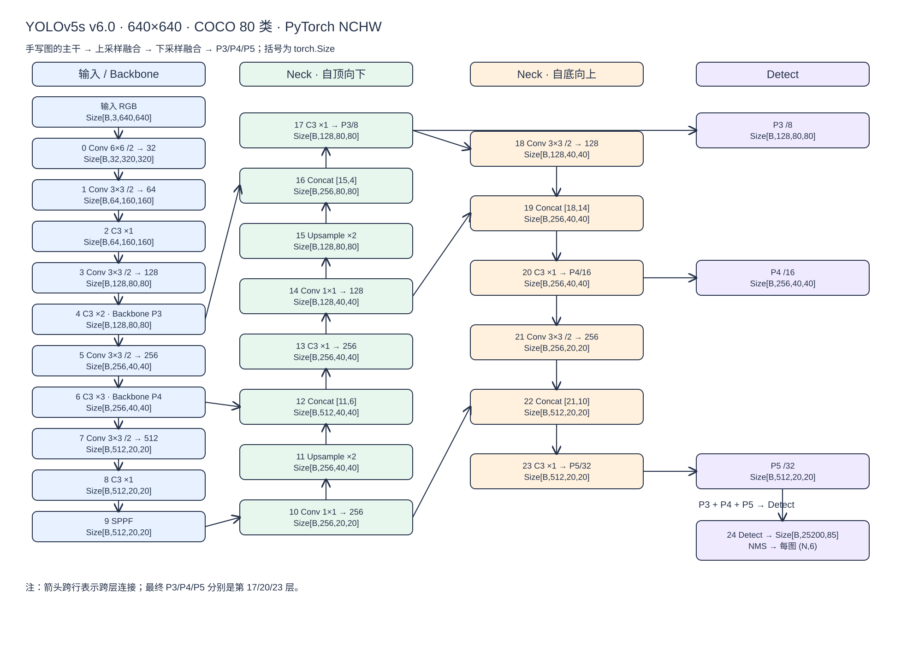
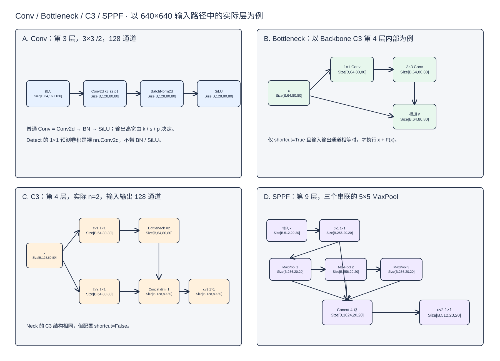
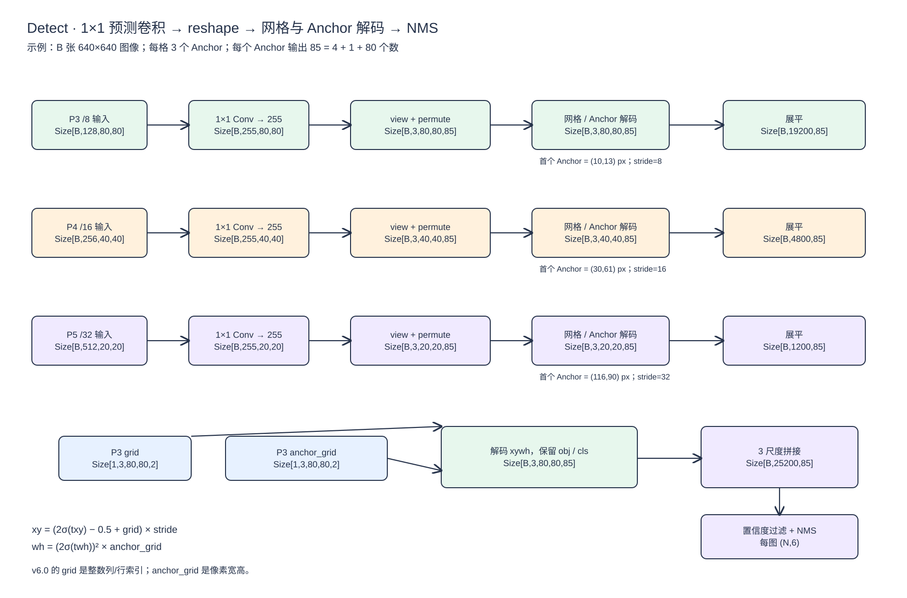

> [!abstract] 阅读约定
> 本笔记整理三页手写图，以 [Ultralytics YOLOv5 **v6.0** 的 `yolov5s.yaml`](https://github.com/ultralytics/yolov5/blob/v6.0/models/yolov5s.yaml) 为准，采用 COCO 的 80 类、输入图像 $640\times640$、每个尺度 3 个 Anchor。图和表中的通道数、C3 重复次数都是 **YOLOv5s 缩放后的实际值**。其他版本的第一层卷积、层号或解码细节可能不同。

## 先看张量维度

手写笔记把读入的图像写成 `(Batch, W, H, 3)`。为了沿用这一记法，设 `W=宽`、`H=高`；图像数组的常见写法其实是 `(B, H, W, 3)`。送入 YOLOv5 的 PyTorch `Conv2d` 前，必须排列为 **NCHW**：`torch.Size([B, 3, H, W])`。以下方图示中 `Size[B,C,H,W]` 是 `torch.Size([B,C,H,W])` 的简写，**并非另一种数据格式**。本例 $H=W=640$，所以宽高交换在数值上不易察觉，处理非正方形输入时仍须按此顺序检查。

```python
# 如果数组确实按用户原记法排列为 (B, W, H, 3)：
x_nchw = x_bwhc.permute(0, 3, 2, 1).contiguous()  # (B, 3, H, W)
# 若是更常见的 (B, H, W, 3)，则用 permute(0, 3, 1, 2)。
```

图中用 $640\times640$ 给出可直接对照 `.shape` 的数值。若预处理后的高、宽分别是 $H,W$ 且均为 32 的倍数，最终 P3/P4/P5 依次为 `torch.Size([B,128,H/8,W/8])`、`torch.Size([B,256,H/16,W/16])`、`torch.Size([B,512,H/32,W/32])`；候选框总数为 $3(HW/8^2+HW/16^2+HW/32^2)$。这里 `/` 表示整数商，实际 `torch.Size` 会显示整数。

## 1. 整体结构：Backbone → Neck → Detect



[打开可编辑的 Excalidraw 原图](01-整体网络.excalidraw)

> [!note] 图像说明
> 图按手写图的箭头路径排布：左侧 Backbone 提取特征；中间上采样并拼接，右侧再下采样并拼接；最终将第 17、20、23 层送入 Detect。图中跨列箭头表示 `Concat` 或 Detect 的跨层输入。`yolov5s.yaml` 把 Neck 与 Detect 都列在 `head` 配置块内；这里按**功能**分开讲。

| 层号  | 运算 / 来源                        | 输出 `.shape`                     | 含义                    |
| --- | ------------------------------ | ------------------------------- | --------------------- |
| 输入  | RGB，NCHW                       | `torch.Size([B, 3, 640, 640])`  | 模型输入                  |
| 0   | Conv，$6\times6$，stride 2，pad 2 | `torch.Size([B, 32, 320, 320])` | v6.0 第一层              |
| 1   | Conv，$3\times3$，stride 2       | `torch.Size([B, 64, 160, 160])` | 下采样                   |
| 2   | C3，实际 1 个 Bottleneck           | `torch.Size([B, 64, 160, 160])` | 空间尺寸不变                |
| 3   | Conv，$3\times3$，stride 2       | `torch.Size([B, 128, 80, 80])`  | P3 尺度                 |
| 4   | C3，实际 2 个 Bottleneck           | `torch.Size([B, 128, 80, 80])`  | Backbone 的 P3 旁路      |
| 5   | Conv，$3\times3$，stride 2       | `torch.Size([B, 256, 40, 40])`  | P4 尺度                 |
| 6   | C3，实际 3 个 Bottleneck           | `torch.Size([B, 256, 40, 40])`  | Backbone 的 P4 旁路      |
| 7   | Conv，$3\times3$，stride 2       | `torch.Size([B, 512, 20, 20])`  | P5 尺度                 |
| 8   | C3，实际 1 个 Bottleneck           | `torch.Size([B, 512, 20, 20])`  | 深层特征                  |
| 9   | SPPF                           | `torch.Size([B, 512, 20, 20])`  | 扩大感受野                 |
| 10  | Conv，$1\times1$                | `torch.Size([B, 256, 20, 20])`  | 缩减通道                  |
| 11  | Upsample，倍率 2                  | `torch.Size([B, 256, 40, 40])`  | 最近邻上采样                |
| 12  | Concat，第 11 与 6 层              | `torch.Size([B, 512, 40, 40])`  | 沿通道维拼接                |
| 13  | C3，实际 1 个 Bottleneck           | `torch.Size([B, 256, 40, 40])`  | 特征融合                  |
| 14  | Conv，$1\times1$                | `torch.Size([B, 128, 40, 40])`  | 缩减通道                  |
| 15  | Upsample，倍率 2                  | `torch.Size([B, 128, 80, 80])`  | 最近邻上采样                |
| 16  | Concat，第 15 与 4 层              | `torch.Size([B, 256, 80, 80])`  | 沿通道维拼接                |
| 17  | C3，实际 1 个 Bottleneck           | `torch.Size([B, 128, 80, 80])`  | **最终 P3 / stride 8**  |
| 18  | Conv，$3\times3$，stride 2       | `torch.Size([B, 128, 40, 40])`  | 向下融合                  |
| 19  | Concat，第 18 与 14 层             | `torch.Size([B, 256, 40, 40])`  | 沿通道维拼接                |
| 20  | C3，实际 1 个 Bottleneck           | `torch.Size([B, 256, 40, 40])`  | **最终 P4 / stride 16** |
| 21  | Conv，$3\times3$，stride 2       | `torch.Size([B, 256, 20, 20])`  | 向下融合                  |
| 22  | Concat，第 21 与 10 层             | `torch.Size([B, 512, 20, 20])`  | 沿通道维拼接                |
| 23  | C3，实际 1 个 Bottleneck           | `torch.Size([B, 512, 20, 20])`  | **最终 P5 / stride 32** |
| 24  | Detect，输入第 17、20、23 层          | 见第 3 节                          | 三尺度预测                 |

其中 C3 的实际次数来自 YAML 的 `depth_multiple=0.33`；通道数来自 `width_multiple=0.50`，经过模型构建逻辑取整。最终 P3/P4/P5 与 Backbone 第 4/6/9 层的旁路不可混为一谈。

## 2. 每个模块内部发生了什么



[打开可编辑的 Excalidraw 原图](02-模块内部.excalidraw)

### Conv

普通 `Conv` 模块是 `Conv2d → BatchNorm2d → SiLU`。卷积核和 stride 由所在层决定，并非 Backbone 的 Conv 都是 $3\times3$、stride 2。例如 v6.0 第 0 层是 $6\times6$、stride 2；第 10、14 层是 $1\times1$、stride 1。卷积的高宽输出按 $\lfloor(H+2p-k)/s\rfloor+1$ 计算，此处均未使用 dilation。**Detect 的预测卷积则是单独的 `nn.Conv2d(…, 1)`，没有普通 Conv 封装里的 BN 与 SiLU。**

### Bottleneck 与 C3

Bottleneck 先经过 $1\times1$ Conv 再经过 $3\times3$ Conv；只有 `shortcut=True` 且输入、输出通道相同时才执行残差相加 $y=x+F(x)$。C3 把输入分为两路：`cv1 → n 个 Bottleneck` 与 `cv2`，在**通道维**拼接，再经 `cv3` 输出。以第 4 层为例，两路各为 `torch.Size([B,64,80,80])`，拼接后为 `torch.Size([B,128,80,80])`，输出仍为 `torch.Size([B,128,80,80])`。Neck 中的 C3 指定 `shortcut=False`。[模块定义见官方 `common.py`](https://github.com/ultralytics/yolov5/blob/v6.0/models/common.py)。

### SPPF

第 9 层输入为 `torch.Size([B,512,20,20])`。`cv1` 把通道降至 256；$5\times5$、stride 1、pad 2 的 MaxPool **串联三次**，得到三个同形张量；连同池化前张量一起拼接为 `torch.Size([B,1024,20,20])`；`cv2` 输出 `torch.Size([B,512,20,20])`。因此 SPPF 不改变空间尺寸。[实现见官方 `common.py`](https://github.com/ultralytics/yolov5/blob/v6.0/models/common.py)。

## 3. Detect、Anchor 与张量形状



[打开可编辑的 Excalidraw 原图](03-Detect与Anchor.excalidraw)

每个网格有 3 个 Anchor，每个 Anchor 预测向量长度为 $85=4+1+80$：4 个框参数、1 个目标存在分数（objectness）、80 个类别分数。**Anchor 本身只有宽高先验 `(a_w,a_h)`，不是 85 维预测向量。**

| 阶段 | P3 / stride 8 | P4 / stride 16 | P5 / stride 32 |
| --- | --- | --- | --- |
| Detect 输入 | `torch.Size([B,128,80,80])` | `torch.Size([B,256,40,40])` | `torch.Size([B,512,20,20])` |
| 独立 $1\times1$ 预测卷积 | `torch.Size([B,255,80,80])` | `torch.Size([B,255,40,40])` | `torch.Size([B,255,20,20])` |
| `view + permute` | `torch.Size([B,3,80,80,85])` | `torch.Size([B,3,40,40,85])` | `torch.Size([B,3,20,20,85])` |
| 展平候选框 | `torch.Size([B,19200,85])` | `torch.Size([B,4800,85])` | `torch.Size([B,1200,85])` |

推理模式下，各尺度先解码、再展平、再拼接，得到 `torch.Size([B,25200,85])`，因为 $3(80^2+40^2+20^2)=25200$。**训练模式**的 `Detect.forward()` 返回三个尺度尚未解码的张量列表；此处的 `torch.Size([B,25200,85])` 是普通推理模式中的解码输出，且不等于 NMS 后的检测结果。[`Detect.forward()` 官方代码](https://github.com/ultralytics/yolov5/blob/v6.0/models/yolo.py)。

### Anchor 的两个尺度

v6.0 默认 P3 的三个像素尺度 Anchor 为 `(10,13)`、`(16,30)`、`(33,23)`。建模时，代码把它们除以 stride 8，得到特征图尺度的 Anchor；`_make_grid()` 再乘回 stride，得到用于解码的**像素尺度** `anchor_grid`，形状为 `torch.Size([1,3,80,80,2])`。同一个 Anchor 宽高被广播到该尺度的所有网格位置。整数网格坐标 `grid` 也是 `torch.Size([1,3,80,80,2])`，最后一维是 `(列索引, 行索引)`。

### 从网络输出解码为像素坐标

设某个候选框原始输出为 $(t_x,t_y,t_w,t_h,t_o,t_{c_1},\dots,t_{c_{80}})$，网格整数坐标为 $(g_x,g_y)$，stride 为 $s$，该 Anchor 的**像素**宽高为 $(a_w,a_h)$。v6.0 的解码式是

$$
\begin{aligned}
x_c&=(2\sigma(t_x)-0.5+g_x)s, &y_c&=(2\sigma(t_y)-0.5+g_y)s,\\
w&=(2\sigma(t_w))^2a_w, &h&=(2\sigma(t_h))^2a_h.
\end{aligned}
$$

> [!warning] `grid` 的版本细节
> 在本笔记对应的 **v6.0** 源码里，`_make_grid()` 返回的是整数网格坐标，`-0.5` 写在解码式中。若读另一版本源码时发现 `grid` 已提前减去 `0.5`，后续就不能再减一次。核对公式时务必先看当前代码中 `grid` 的定义。

手写图的 P3 例子：第 20 行、第 30 列，stride 8，首个 Anchor `(10,13)`，且四个原始坐标输出均为 0。因为 $\sigma(0)=0.5$，得到 $(x_c,y_c,w,h)=(244,164,10,13)$，单位是**模型输入图像上的像素**，不是特征图格数。这里 `x` 对应列，`y` 对应行。

objectness 与类别分别经过 sigmoid。类别 $i$ 的候选框分数是 $\sigma(t_o)\sigma(t_{c_i})$，不是对 80 类做 softmax。后处理按阈值筛选、将 `xywh` 转为 `xyxy`、执行 NMS；每张图留下数量可变的检测，常用表示为 `torch.Size([N,6])`，每行为 `(x1,y1,x2,y2,conf,class)`。NMS 后若要回到原图坐标，还需撤销 letterbox 的缩放与 padding。

## 4. 手写页中的预处理例子

原图宽高为 $1280\times720$，目标边长 640。保持长宽比缩小 0.5 倍，得到 $640\times360$。若使用 `letterbox(new_shape=640, auto=True, stride=32)`，只需把高度补到最接近的 32 倍数 384，即上下各补 12 像素；进入模型时是 `torch.Size([B,3,384,640])`。此时最终三个尺度的空间大小依次是 `48×80`、`24×40`、`12×20`，候选框总数为 $3(48\cdot80+24\cdot40+12\cdot20)=15120$。若 `auto=False`，通常填充到 `640×640`，这时才是前述 25200 个候选框。[`letterbox()` 官方代码](https://github.com/ultralytics/yolov5/blob/v6.0/utils/augmentations.py)。

## 复习时抓住这条主线

`BWHC/BHWC 图像 → NCHW → Backbone 的多尺度特征 → Neck 双向融合 → P3/P4/P5 → 1×1 预测卷积 → [B,3,H,W,85] → Anchor + grid 解码 → [B,候选框数,85] → 置信度筛选与 NMS`。
